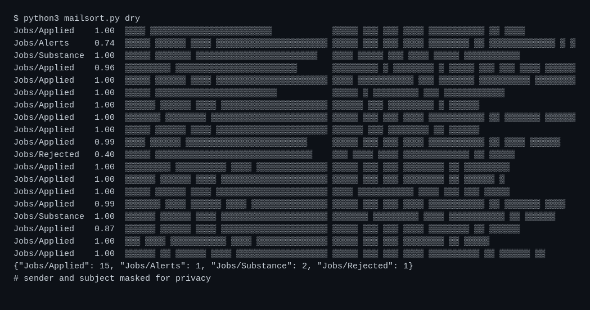

# mailsort

Sorts a Gmail inbox with an LLM judge so job mail that needs action stays visible and the rest is archived.

## Why

A job search floods the inbox with alerts, confirmations, and rejections. The few messages that need action get buried. mailsort reads every new mail and keeps only the substance in front of the reader. The same shape works for sorting inbound leads or outbound replies by intent.

## How it works

- Jev, TypeSafe's classification model, labels each new mail into five categories: Jobs/Substance, Jobs/Applied, Jobs/Rejected, Jobs/Alerts, Jobs/Other.
- Jobs/Substance means the company wants action: interview, assessment, offer, or a recruiter question. That mail stays in the inbox.
- Jobs/Applied, Jobs/Rejected, and Jobs/Alerts are archived by deleting them from INBOX (kept in All Mail). Jobs/Other stays.
- Low confidence (under 0.5) keeps a mail visible instead of archiving it.
- Every handled mail gets a Jobs/* label, so a re-run only sees new mail.
- Mail is classified in parallel with 16 threads. Substance mail is appended to a log and raises a desktop notification.

## Stack

Python 3, Gmail IMAP, TypeSafe Jev API, systemd

## Run it

- Put the Gmail address and app password in `~/.config/mailsort/env` as `USER` and `PASS`.
- Put the TypeSafe key in `~/.config/typesafe/env` as `TYPESAFE_API_KEY`.
- Dry run: `python3 mailsort.py dry` classifies and prints, changes nothing.
- Install the units from `systemd/` to `~/.config/systemd/user/` and enable `mailsort.timer`. It runs every 30 minutes and starts 5 minutes after boot.
- Set `MAILSORT_LOG` to change where substance mail is logged (default `~/mail-substance.md`).
